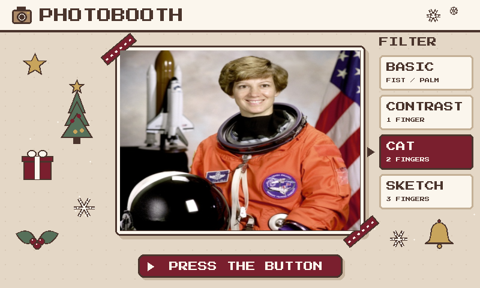
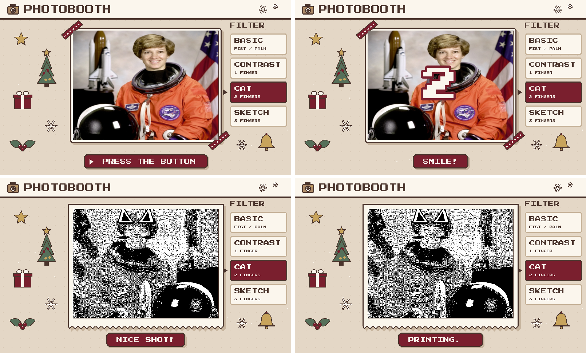
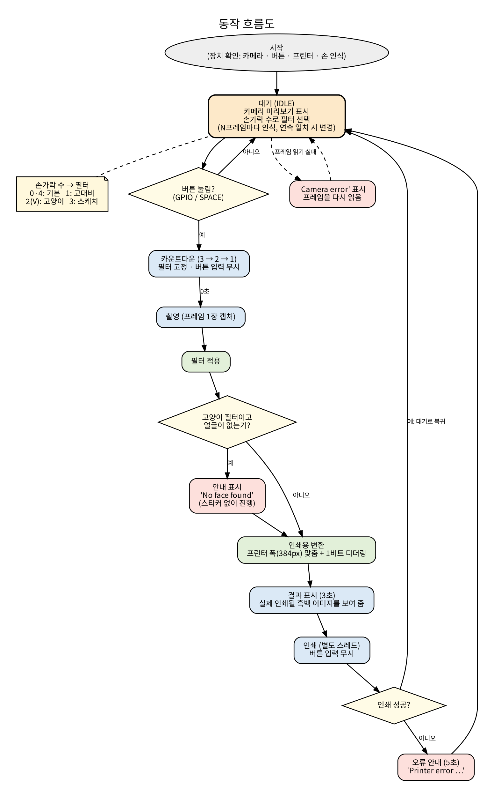
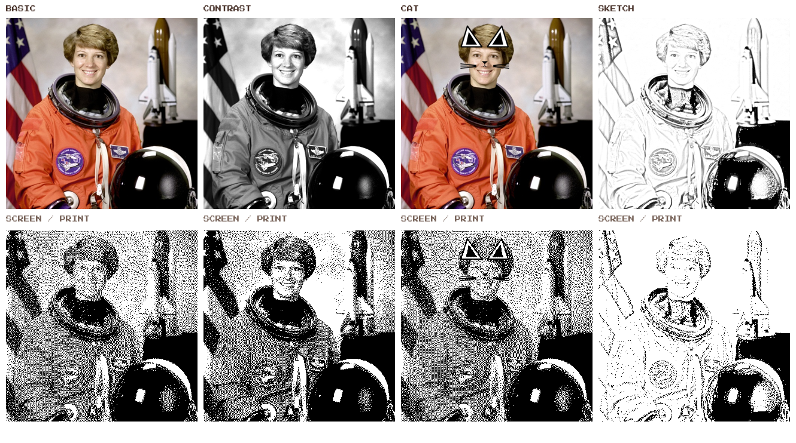
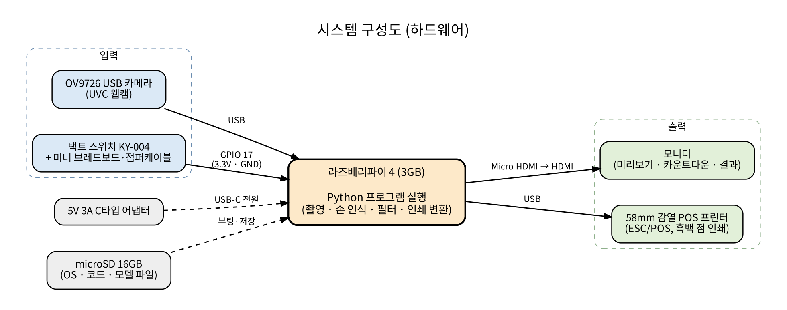
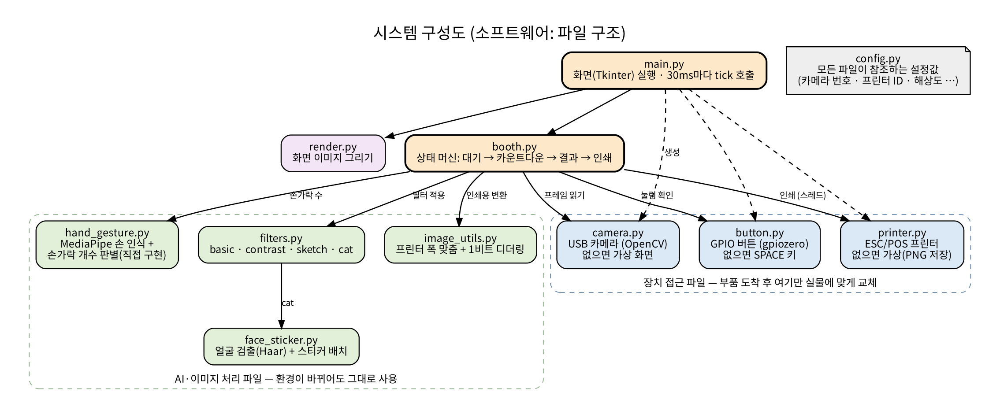

# 라즈베리파이 포토부스

손 모양으로 필터를 고르고, 버튼을 누르면 촬영해서 감열 프린터로 인쇄하는 포토부스.
IoT 과목 팀 프로젝트이며, 현재 **Mac에서 전체 흐름이 동작하는 단계**다. 라즈베리파이와 실물 장치 연결은 부품 도착 후 진행한다.



## 한눈에 보기

| 구분 | 내용 |
|---|---|
| 입력 | USB 카메라(OV9726), 버튼(KY-004, GPIO) |
| 처리 | 라즈베리파이 4 (3GB) · Python, OpenCV, MediaPipe |
| 출력 | 모니터(HDMI), 58mm 감열 POS 프린터(USB, ESC/POS) |
| 특징 | 손가락 개수로 필터 선택 · 인쇄용 흑백(1비트) 변환 · 장치가 없어도 가상 장치로 개발 가능 |

## 진행 상황 (2026-11-11 기준)

| 항목 | 상태 | 비고 |
|---|---|---|
| 촬영 → 카운트다운 → 결과 → 인쇄 흐름 | 완료 | Mac(내장 웹캠), 가상 프린터 |
| 손가락 개수로 필터 선택 | 완료 | MediaPipe 손 인식 모델 필요 |
| 필터 4종 (기본, 고대비, 고양이, 스케치) | 완료 | |
| 화면(UI) 5종, 크리스마스 테마 | 완료 | 테마는 설정으로 변경 가능 |
| 라즈베리파이에 코드 적용 | 예정 | 라즈베리파이 도착 후 |
| USB 카메라 · 버튼 · 프린터 실물 연결 | 예정 | 아직 검증하지 못함 |
| 외관(박스) 제작 | 예정 | |
| 필터 품질 개선 | 예정 | 인쇄 변환 조정, 스티커 기울기 대응 |

## 화면 (UI)

레트로 픽셀 스타일의 크리스마스 테마. 옅은 브라운 바탕에 버건디를 포인트로 썼다.



| 화면 | 내용 |
|---|---|
| 대기 | 카메라 미리보기, 필터 목록(현재 필터 강조), "PRESS THE BUTTON" |
| 카운트다운 | 3, 2, 1과 "SMILE!" |
| 결과 | **실제 인쇄될 흑백 이미지**를 영수증 종이 모양으로 표시 |
| 인쇄 중 | "PRINTING..." |
| 오류 | 프린터·카메라 오류를 알림 띠로 표시하고 대기로 복귀 |

- 화면 틀은 800x480 기준에서 픽셀 단위로 그린 뒤 모니터 크기에 맞게 확대하고, 카메라 사진만 따로 붙인다
- 테마는 `config.py`의 `THEME`으로 바꾼다 (`christmas` / `pastel`)

## 동작 방식



1. **대기**: 카메라 미리보기를 보여 주며 손 모양을 인식해 필터를 고른다
2. **버튼(또는 SPACE)**: 카운트다운이 시작되고 필터가 고정된다
3. **촬영 → 필터 적용 → 인쇄용 변환**: 사진 한 장에만 처리한다
4. **결과 표시 → 인쇄**: 인쇄는 별도 스레드로 실행해 화면이 멈추지 않는다
5. 인쇄 중 버튼 입력은 무시하고, 프린터 오류가 나면 안내 후 대기로 돌아온다

## 필터

손가락 개수(엄지 제외)로 필터를 고른다.

| 손 모양 | 필터 | 설명 |
|---|---|---|
| 주먹 / 손바닥 / 손 없음 | basic | 기본 |
| 검지 1개 | contrast | 명암을 강하게 |
| V 사인 (2개) | cat | 얼굴에 고양이 귀·코·수염 |
| 3개 | sketch | 연필 스케치 |



위 줄은 화면에 보이는 모습, 아래 줄은 감열 프린터로 실제 찍힐 흑백 점 이미지다.

**설계 결정과 이유**

| 결정 | 이유 |
|---|---|
| 손가락 개수는 직접 만든 규칙으로 판별 | MediaPipe는 관절 좌표만 준다. 손목에서 손가락 끝까지의 거리가 두 번째 마디까지의 거리보다 1.2배 넘게 멀면 "펴짐"으로 판단한다. 거리로 비교하므로 손이 기울어도 맞는다 |
| 엄지는 세지 않음 | 엄지는 굽는 방향이 달라 오판이 잦다. 네 손가락만 세어 0~4로 구분한다 |
| 같은 결과가 연속 4번일 때만 필터 변경 | 한 프레임짜리 오인식을 무시한다 |
| 인식은 N프레임마다, 축소 해상도(320x240)로 | 라즈베리파이의 CPU 부담을 줄이기 위해서 |
| 필터는 촬영한 한 장에만 적용 | 미리보기에서 매 프레임 처리하지 않아도 되어 가볍다 |
| 피부 보정 같은 미세한 필터는 제외 | 감열 프린터는 흑백 점으로 찍어서 미세한 톤 변화가 인쇄물에서 거의 보이지 않는다 |
| 결과 화면에 인쇄용 이미지를 그대로 표시 | 사용자가 실제로 찍힐 모습을 미리 볼 수 있다 |

## 구조

장치와 닿는 파일(`camera.py`, `button.py`, `printer.py`)을 따로 분리했다. 실물이 없으면 자동으로 가상 장치로 대체되고, 부품이 도착하면 이 파일들과 `config.py`만 실물에 맞추면 된다.





| 파일 | 역할 |
|---|---|
| `main_cv.py` | 실행 파일 (OpenCV 창). Mac에서 권장 |
| `main.py` | 실행 파일 (Tkinter). 최신 Tk 환경용 |
| `booth.py` | 동작 순서(상태 머신) |
| `render.py` | 화면 이미지 그리기 (테마, 장식, 레이아웃) |
| `camera.py` `button.py` `printer.py` | 장치 접근 (없으면 가상 장치) |
| `hand_gesture.py` | MediaPipe 손 인식 + 손가락 개수 판별 |
| `filters.py` `face_sticker.py` | 필터와 고양이 스티커 |
| `image_utils.py` | 프린터 폭 맞춤, 1비트 변환 |
| `config.py` | 모든 설정값 |
| `make_stickers.py` | 스티커 PNG 생성 |
| `tests/test_pipeline.py` | 하드웨어 없이 돌리는 검증 |

## 시작하기 (Mac)

Python 3.9 이상. 아래는 실제로 동작을 확인한 순서다.

```bash
git clone https://github.com/angelnumb8r/raspberry-pi-photobooth.git
cd raspberry-pi-photobooth

python3 -m venv .venv
source .venv/bin/activate
python -m pip install --upgrade pip
python -m pip install "opencv-python>=4.8,<5" pillow numpy python-escpos pyusb gpiozero
python -m pip install --no-compile mediapipe
```

손 인식 모델은 저장소에 없으므로 따로 내려받는다 (약 7.8MB).

```bash
curl -L -o models/hand_landmarker.task \
  https://storage.googleapis.com/mediapipe-models/hand_landmarker/hand_landmarker/float16/latest/hand_landmarker.task
```

검증과 실행:

```bash
python tests/test_pipeline.py     # 마지막 줄이 ALL PASSED면 정상
python main_cv.py                 # 창을 한 번 클릭한 뒤 SPACE로 촬영, ESC 또는 q로 종료
```

시작할 때 터미널에 어떤 장치가 실물이고 어떤 것이 가상인지 출력된다. 카메라가 없으면 `config.py`의 `FAKE_CAMERA_IMAGE = "tests/sample.jpg"`로 사진을 대신 쓸 수 있다.

## 라즈베리파이에서 (예정)

| 단계 | 통과 기준 |
|---|---|
| 1. OS 설치 (64비트 + 데스크톱) | 부팅됨 |
| 2. 접속(VNC), 환경 확인 | `aarch64` 확인 |
| 3. 코드 받기, 패키지·모델 설치 | 위 설치 확인 명령 통과 |
| 4. 화면 실행 | 얼굴과 필터가 보임 |
| 5. 버튼 배선 | 누르면 촬영 시작 |
| 6. 프린터 연결 | 종이로 인쇄됨 |
| 7. 통합, 자동 시작 | 전원만 켜면 포토부스 실행 |

- MediaPipe 설치에는 64비트 OS가 필요하다 ([공식 설정 안내](https://developers.google.com/edge/mediapipe/solutions/setup_python) 기준 Raspberry Pi OS 64-bit)
- 버튼 모듈(KY-004)은 GPIO 보호를 위해 5V가 아닌 3.3V에 연결한다
- 프린터는 자체 전원 어댑터를 쓰고 라즈베리파이 전원과 분리한다

## 설정 (`config.py`)

| 항목 | 설명 |
|---|---|
| `CAMERA_INDEX` | 카메라 번호 (`ls /dev/video*`로 확인) |
| `PRINTER_USB_IDS` | 프린터 `(vendor_id, product_id)` (`lsusb`로 확인). `None`이면 가상 프린터 |
| `PRINT_WIDTH` | 프린터 가로 점 수 (58mm는 보통 384) |
| `GPIO_BUTTON_PIN`, `BUTTON_PULL_UP` | 버튼 핀 번호와 극성 (반응이 반대면 `BUTTON_PULL_UP`을 바꿈) |
| `CAMERA_SIZE`, `DETECT_SIZE`, `DETECT_EVERY_N_FRAMES` | 미리보기가 끊길 때 조정 |
| `THEME` | 화면 테마 (`christmas` / `pastel`) |

## 문제 해결 기록

개발 중 만난 문제와 해결 방법.

| 문제 | 원인 | 해결 |
|---|---|---|
| `mp.solutions`가 없다는 오류 | 최신 MediaPipe에서 예전 API가 제거됨 | Tasks API(`HandLandmarker`)로 변경하고 모델 파일을 따로 내려받음 |
| 얼굴을 못 찾음 | OpenCV 5.x에는 얼굴 검출용 Haar 파일이 빠져 있음 | `opencv-python<5`로 고정 |
| `mediapipe` 설치가 마지막에 실패 | 패키지 안의 테스트 파일 때문에 pip의 컴파일 단계에서 오류 | `--no-compile` 옵션으로 설치 |
| Tk 창이 비어 보임 | macOS 기본 Python의 Tk 8.5 문제 | OpenCV 창(`main_cv.py`)으로 대체 |
| 카메라가 열리지 않음 | macOS가 터미널의 카메라 접근을 허용하지 않음 | 시스템 설정에서 터미널의 카메라 권한을 켜고 터미널을 다시 시작 |

## 한계와 개선 계획

- 라즈베리파이, USB 카메라, 버튼, 프린터는 아직 실물로 검증하지 못했다. 프레임 속도 등 성능도 실물에서 측정해야 한다
- 고양이 스티커는 정면 얼굴 기준이라 고개를 기울이면 스티커가 따라 기울지 않는다. MediaPipe Face Landmarker로 눈 좌표를 쓰면 개선할 수 있다
- 인쇄 변환(대비, 밝기, 디더링 방식) 조정으로 인쇄 품질을 높일 수 있다
- 화면 글자는 영어로만 표시한다

## 문서

- [개발 일지 양식](docs/dev_log_template.md)
- 구성도와 흐름도 이미지: `docs/`

## 라이선스와 출처

- 코드: 별도 라이선스 파일은 아직 없다
- 글꼴 Press Start 2P: SIL Open Font License 1.1 (`assets/fonts/OFL.txt`)
- `tests/sample.jpg`: scikit-image 샘플 이미지(우주비행사). 테스트와 문서 이미지용
- 고양이 스티커와 화면 장식: 이 저장소의 코드(`make_stickers.py`, `render.py`)로 직접 그림
- 손 인식 모델(`hand_landmarker.task`)은 저장소에 포함하지 않으며 Google MediaPipe에서 내려받는다
